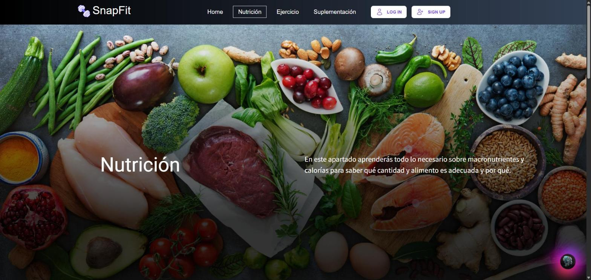
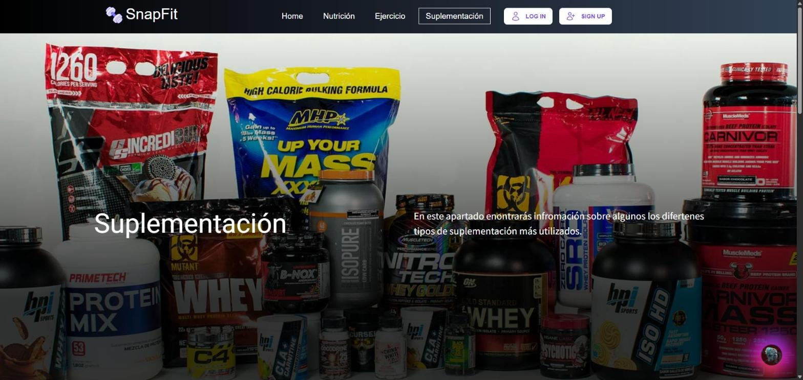
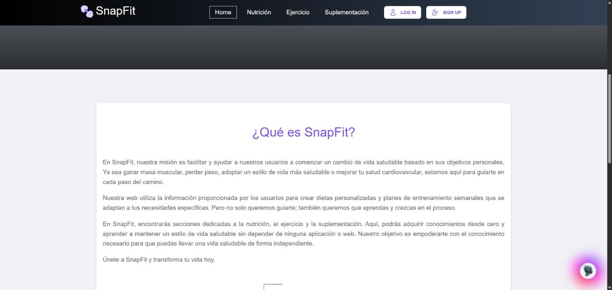
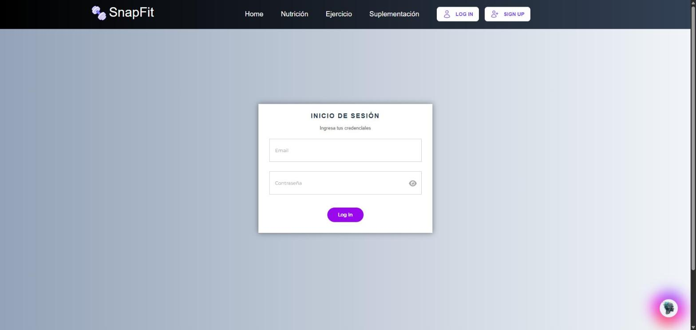

# SnapFit

A full-stack fitness and nutrition web app. You tell it your age, weight, height, activity level and goal, and it builds you a **personalised diet and weekly workout plan**, then tracks your progress with charts. It also includes an **AI assistant** (OpenAI) for nutrition and training questions.

Built as a university project (2024) with **React, Node.js/Express, MongoDB and Docker**.

## What it does

- **Personal calorie and macro targets.** Calculates daily calories with the Mifflin-St Jeor formula, adjusted for activity level and goal (lose weight, build muscle, healthy lifestyle, cardiovascular health), then splits them into protein, carbs and fat.
- **Weekly diet plan.** Picks meals from a nutrition database by meal type and calorie target, and respects the user's food restrictions.
- **Weekly workout plan.** Assigns a routine that matches the user's goal and the number of days they can train.
- **Progress tracking.** Weight, BMI and body measurements (arm, chest, waist, thigh) over time, shown in interactive charts (Chart.js).
- **AI assistant.** A floating chatbot that answers nutrition and exercise questions, and an endpoint that generates a diet and workout plan as JSON from a prompt.
- **Accounts.** Sign up, log in, change password. Protected pages for logged-in users only.
- **Content pages.** Exercise library, supplements guide and nutrition basics.

## Screenshots

Public pages of the web app (the logged-in area needs a database to run).

| | |
| --- | --- |
|  |  |
|  |  |
|  | |

## Tech stack

| Layer | Tools |
| --- | --- |
| Frontend | React 18, Vite, React Router, Tailwind CSS, SCSS, Chart.js |
| Backend | Node.js, Express, Mongoose |
| Database | MongoDB |
| Auth and security | JWT, bcrypt (12 rounds), Helmet, CORS allow-list, rate limiting |
| AI | OpenAI Chat Completions API |
| DevOps | Docker, Docker Compose |

## Security notes

- Secrets are read from environment variables (`backend/.env`, see `backend/.env.example`). Nothing sensitive is stored in the repository.
- Passwords are hashed with bcrypt. Private routes require a valid JWT.
- Every OpenAI call costs money, so those routes have a stricter rate limit (10 requests per IP per 15 minutes) and a prompt length cap, and the plan-generation endpoints require a logged-in user.

## Run it locally

You need Docker, a MongoDB instance and an OpenAI API key.

```bash
cp backend/.env.example backend/.env   # then fill in your own values
docker compose up --build
```

- Frontend: http://localhost:5173
- Backend API: http://localhost:3030

## Project structure

```
backend/
  app.js            Express app, middleware and routes
  routes/           auth, users, diet, exercises, weight, BMI, measurements, openai
  models/           Mongoose models (user, diet, exercise, nutrition, trackers)
  utils/            calorie calculator, diet and routine assignment
  middleware/       JWT auth, rate limiting
frontend/
  src/pages/        public pages and the logged-in area (profile, health, nutrition, exercises)
  src/components/   UI, charts, chatbot
```
